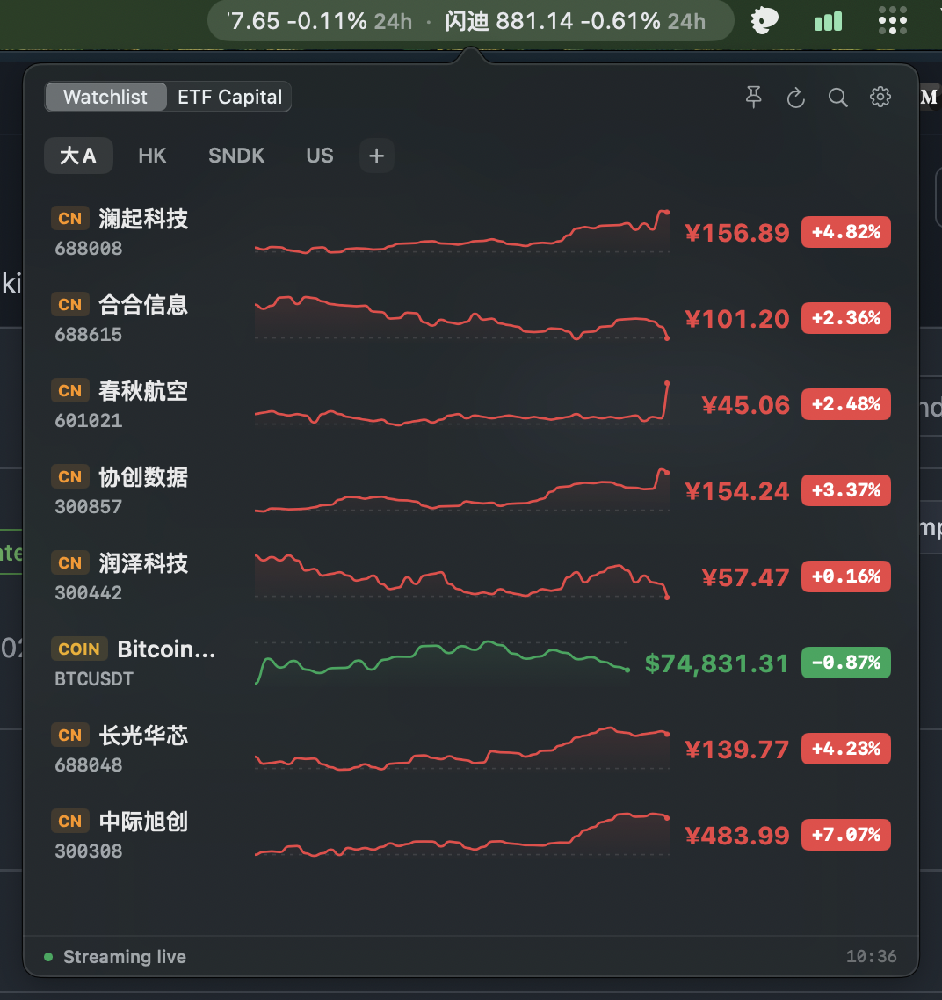
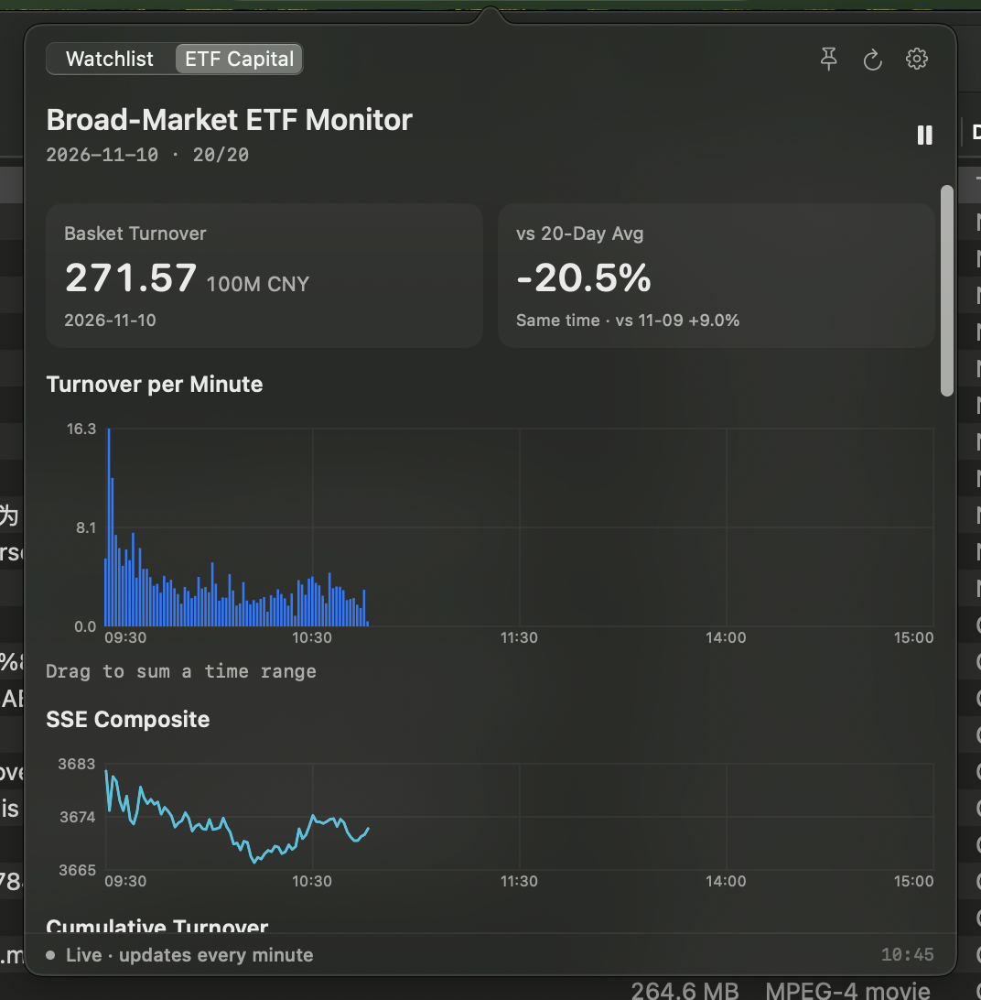
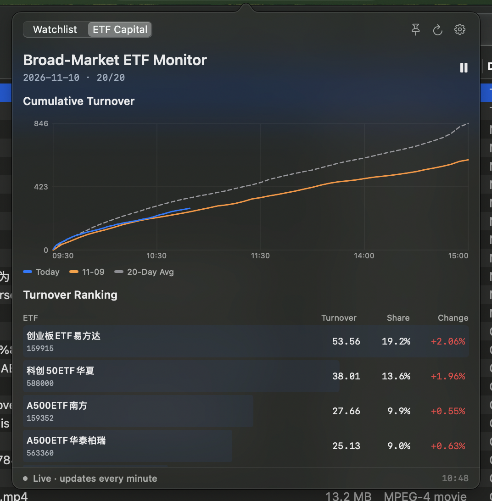

# TickBar

**macOS 菜单栏上的轻量盯盘工具** — 实时滚动自选股价格,一键查看持仓盈亏。
*A lightweight macOS menu bar app for live stock quotes and portfolio P&L.*

[简体中文](README.md) · [English](README.en.md)

[](LICENSE)
[](https://www.apple.com/macos)
[](https://swift.org)
[](https://github.com/darluc/TickBar/actions/workflows/ci.yml)
[](https://github.com/darluc/TickBar/releases/latest)
[](https://github.com/darluc/TickBar/releases)

---

## 一句话简介

TickBar 把 A / 港 / 美三市行情塞进 macOS 菜单栏的一小条滚动文字里。点开 360pt 的紧凑面板看持仓盈亏、大盘指数、价格预警 — 不抢屏幕、不挂网络、不收集任何数据。

## 界面预览

<p align="center">
  
  
  
</p>

## ✨ 致谢 / Acknowledgments

TickBar 最初名为 **PanBar**,开源项目 [PanBar](https://github.com/TNT-Likely/PanBar) 正是它的起点。更名为 TickBar 之后,我们沿用「轻量盯盘」的初心,继续迭代演进。

🙏 致谢原项目:[PanBar](https://github.com/TNT-Likely/PanBar)

## 功能

- **本机 MCP（可选）** — 为 AI Agent 提供只读股票与 ETF 篮子监控接口，默认关闭；见 [docs/MCP.md](docs/MCP.md)
- **菜单栏滚动 ticker** — 自定义勾选要滚动的股票 + 三大汇总指标(今日盈亏 / 总资产 / 累计)
- **多市场覆盖** — A / 港 / 美一站式,**自动按本位币(¥ / $ / HK$)汇总**
- **多自选列表** — 分组管理(新建 / 重命名 / 删除 / 排序),跨组用 **Option+拖拽** 移动,组内拖拽即排序;支持 **Cmd+1 ~ Cmd+9** 快速切换
- **大盘指数** — 8 个预置(沪指 / 深成 / 创业板 / 沪深300 / 恒生 / 道琼斯 / 纳指 / 标普),可选择性显示在 ticker 里
- **价格预警** — 多条件(主+副,AND/OR)、每日触发次数上限、仅交易时段、仅工作日
- **数据源可配** — 腾讯 / 东方财富 / Yahoo / Finnhub / Naver / Binance,**每市场独立优先级**
- **股票搜索** — 中文 / 拼音 / 代码,直连腾讯 smartbox
- **迷你走势** — 基于**真实分时数据**的迷你价格曲线
- **隐私模式** — 屏幕共享/录屏时自动遮蔽 ticker;⌘⌃M 手动一键切换
- **配色方案** — 东方红涨绿跌 / 西方绿涨红跌 / 黑白单色,实时切换
- **多语言** — 简体中文 / English
- **可自定义快捷键** — 全局录入器,你想用啥按啥
- **全量备份恢复** — 一个 JSON 文件包含全部持仓 / 自选 / 预警 / 设置
- **完全本地** — SQLite + 启动期 FX 缓存 · 无埋点 · 无云同步 · 无广告

## 安装

**下载 DMG**(已 Apple Developer ID 公证,首次打开会弹一次「已验证此 App」提示):

[**↓ 下载最新版**](https://github.com/darluc/TickBar/releases/latest) → 双击 `.dmg` → 把 TickBar 拖进 Applications。

或从源码构建:

```bash
brew install xcodegen create-dmg
git clone https://github.com/darluc/TickBar.git
cd TickBar
make run         # 一键构建 + 启动
```

## ☕ 支持这个项目 / Support This Project

TickBar 完全免费开源,**无广告无付费功能**。如果觉得有用,请作者喝杯咖啡 ☕ 支持持续开发。

**PayPal:** [Buy Me a Coffee](https://paypal.me/imzvz/5USD)

**加密货币打赏 / Crypto Donations**

| Token | Network | Address |
|-------|---------|---------|
| USDC | Base | `0x7341369a4073d728e59b64c20e50e804898ffc41` |


> 请仅在 Base 网络上发送 USDC。
> 发送前请再次确认网络。

感谢支持开源!❤️

## 本机 MCP 与 Agent Skill

TickBar 可在**本机**为 AI Agent（如 Claude Code、Cursor 等）提供只读行情接口，**默认关闭**，需在 **设置 → 通用 → 本机 MCP** 中开启。完整说明见 [docs/MCP.md](docs/MCP.md)。

| 项目 | 说明 |
| --- | --- |
| 地址 | `http://127.0.0.1:18766/mcp`（仅回环，需 Bearer 令牌） |
| `get_stock_quotes` | 按市场（`a` / `hk` / `us` / `kr`）与代码列表查询股票行情 |
| `get_etf_snapshot` | 20 只 ETF 篮子：成交额总量与分时累计、较前一交易日 / 近 N 日均值对比、大中小单成交分类、分 ETF 排名 |

**Agent Skill（可选）**：仓库内 [`skills/tickbar-market-data/SKILL.md`](skills/tickbar-market-data/SKILL.md) 说明如何选工具、理解字段含义（元 vs 亿元、pace 比例、分档口径等）。将 skill 安装到你的 Agent 配置中可帮助模型稳定调用；不安装也可直接对接 MCP。

## 开发文档

- [本机 MCP](docs/MCP.md)：启用方式、工具列表、认证与限流说明。
- [ETF 面板实现说明](docs/ETF-PANEL.md)：数据接口、刷新规则、统计口径、性能设计及已移除的功能。
- [个股分析](docs/STOCK-VOLUME.md)：自选股右键入口、分类口径、逐分钟对账、公开持仓、刷新规则及接口验证结果。
- [限流与退避](docs/RATE-LIMITING.md)：各数据源的请求节奏、门控、429 处理、备用源与缓存策略。

## License

MIT — 详见 [LICENSE](LICENSE)。
